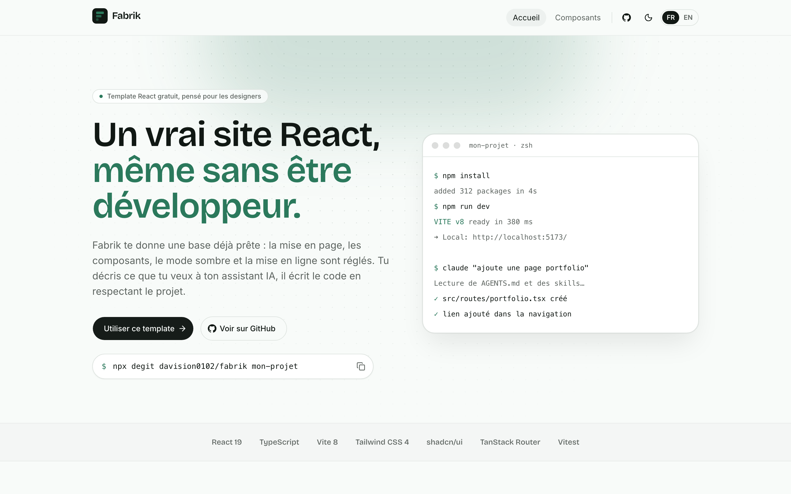

<div align="center">

[Français](README.md) · **English**


# Fabrik

A free React template to build a real website, even if you're not a developer.

[](https://github.com/davision0102/fabrik/actions/workflows/ci.yml)
[](https://davision0102.github.io/fabrik/)


[See the demo](https://davision0102.github.io/fabrik/) · [Use this template](https://github.com/davision0102/fabrik/generate) · [Step-by-step guide](#getting-started-step-by-step)



</div>

## Why I made this

I'm a designer at heart. For a long time, going from a mockup to a real website meant struggling: installing tools I didn't even know the names of, following tutorials that no longer worked, breaking something without knowing what.

AI assistants have made all of this much more approachable. But one thing was missing: a good starting point. A clean, ready-to-go project that the AI actually understands, instead of turning it into a mess.

Fabrik is that starting point. I use it for my own projects, and I'm sharing it for anyone in the same situation I was in.

> The site comes in French and English, with an FR / EN switch in the menu. The AI skills are written in French, which assistants handle just fine.

## Who it's for

- **Designers** who want to put their designs online themselves
- **Beginners** who want a project that works from day one, without configuring everything
- **Developers** who just want to save an hour at the start of every project

## What's already set up

- **A component library**: buttons, inputs, dialogs, cards… You can see them all on the `/ui` page of the site, like a Figma library.
- **A design system in variables**: colors, fonts and corner radius live in a single file. Change the main color, and the whole site follows.
- **Light and dark mode**, out of the box.
- **French and English**: an FR / EN switch in the menu, with all the text in two easy-to-edit files.
- **Instructions for your AI assistant**: it knows how to add a page or a component without breaking the rest.
- **From mockup to website**: share a Figma link or a screenshot, and the assistant builds it with the project's components.
- **Safety nets**: if something's wrong in the code, you find out before it goes live.
- **Free hosting** on GitHub Pages, with a real link to share.

## Getting started, step by step

If you've never started a code project before, follow these steps in order. Plan for about twenty minutes the first time.

### What you need

1. **A GitHub account**, free, at [github.com](https://github.com). That's where your project will live.
2. **Node.js**, from [nodejs.org](https://nodejs.org). Pick the "LTS" version and install it like any other app. It's the engine that runs the project on your computer.
3. **An editor with an AI assistant.** Pick one:
   - [Cursor](https://cursor.com), the easiest way to start
   - [VS Code](https://code.visualstudio.com) with [Claude Code](https://claude.com/claude-code)
   - the [Claude](https://claude.ai/download) app, Code tab

### 1. Create your own project

At the top of this page, click the green **Use this template** button, then **Create a new repository**. Give it a name (for example `my-portfolio`) and confirm.

You now have your own copy of Fabrik on GitHub. It's yours, you can change anything.

### 2. Get it on your computer

In Cursor or VS Code, choose **Clone Git Repository** on the welcome screen, paste the address of your new repository (the one from the GitHub page) and pick a folder.

### 3. Run the site

Open the editor's built-in terminal (menu **Terminal › New Terminal**), then type these two commands, one after the other:

```bash
npm install
npm run dev
```

The first one downloads what the project needs (only once). The second one starts the site. Open [localhost:5173](http://localhost:5173) in your browser: that's your site, running on your computer. It updates by itself every time you make a change.

### 4. Ask your assistant for what you want

Open the assistant's chat in your editor and write the way you'd talk to a developer. For example:

- "Rename the project to Studio Lumen and change the main color to forest green"
- "Replace the home page with my portfolio: a short intro, then my projects in a grid"
- "Add a contact page with a name, email and message form"
- "Use the Fraunces font for headings"
- "Build this design:" followed by a Figma link or a screenshot
- "Do a polish pass on the home page"

It reads the project's instructions and follows its rules. Check the result in your browser and adjust as you go.

### 5. Put your site online

Just once: on your project's GitHub page, go to **Settings › Pages** and choose **GitHub Actions** as the source.

Then, whenever you want to publish: ask your assistant to "commit and push my changes to GitHub", or use the **Commit** then **Sync** buttons in your editor. A few minutes later, your site is live at `https://your-username.github.io/project-name/`.

### If you get stuck

- **Copy the error message and paste it to your assistant.** It's often the fastest fix.
- If the site stops showing up, check that `npm run dev` is still running in the terminal.
- Still stuck? [Open an issue](https://github.com/davision0102/fabrik/issues) explaining what you did, and I'll help.

### A small glossary

| Word        | What it means                                                 |
| ----------- | ------------------------------------------------------------- |
| Terminal    | the window where you type commands instead of clicking        |
| `npm`       | the tool that installs and runs the project (comes with Node) |
| Repository  | your project's folder, stored on GitHub                       |
| Commit      | a saved snapshot of your changes, with a short message        |
| Push / Sync | sending your saved changes to GitHub                          |
| Component   | a reusable element, like a component in Figma                 |
| `localhost` | your site's address while it runs on your computer            |
| Deploy      | putting the site online                                       |

## Working with AI

AI assistants (Claude Code, Cursor, Codex, Copilot…) read the `AGENTS.md` file at the root of the project. It explains how the project is organized and which rules to follow, like using the theme's colors instead of making up new ones.

For common tasks, the project also includes 11 step-by-step guides, called "skills", in `.agents/skills/`. You don't need to know them: the assistant picks the right one based on what you ask. They're written in French, which assistants handle just fine.

**For design**

| Skill           | What it has the assistant do                                             |
| --------------- | ------------------------------------------------------------------------ |
| `from-figma`    | turn your design (Figma link or screenshot) into a real page, faithfully |
| `polish-ui`     | do a finishing pass: states, mobile, dark mode, accessibility            |
| `add-motion`    | add useful animations with the right timing, without overdoing it        |
| `design-system` | stick to your colors, fonts and spacing                                  |

**For building**

| Skill           | What it has the assistant do         |
| --------------- | ------------------------------------ |
| `add-page`      | create a page and add it to the menu |
| `add-component` | install a component or create one    |
| `add-form`      | build a form with field validation   |
| `fetch-data`    | show data coming from an API         |

**For the project**

| Skill      | What it has the assistant do               |
| ---------- | ------------------------------------------ |
| `add-test` | write a test                               |
| `deploy`   | put the site online                        |
| `rebrand`  | rename the project and change its identity |

### Going further: design skills to install

Other designers share their own skills, and they work really well with Fabrik. They're not bundled, so you always get their latest version: install the ones you like with a single command in the project's terminal.

- **[Impeccable](https://github.com/pbakaus/impeccable)**, by Paul Bakaus: a design vocabulary for your assistant. Ask it to critique a page, polish it, or make the design bolder, and it spots the visual tics typical of AI-made sites.
  ```bash
  npx impeccable install
  ```
- **[Emil Kowalski's skills](https://github.com/emilkowalski/skills)**, by the creator of Sonner and Vaul: animations, interface details, stress tests with extreme content. The best known is `emil-design-eng`, which teaches the assistant the details that make an interface feel high-end.
  ```bash
  npx skills@latest add emilkowalski/skills
  ```
- **The Figma MCP server**: if you use Figma, it lets the assistant read your designs straight from a link. The `from-figma` skill uses it automatically. Setup depends on your editor: search for "Figma MCP" in its docs.

## Customizing by hand

If you'd rather get your hands in the code:

- **The name and links** are in `src/config/site.ts`, and **the text** is in `src/i18n/fr.ts` and `src/i18n/en.ts`.
- **The main color** is the `--brand` variable in `src/index.css`. There's one for light mode and one for dark mode.
- **Fonts** are set with `--font-heading` and `--font-sans`, in the same file.
- **Pages** are in `src/routes/`: one file is one page.

## For developers

Stack: React 19, TypeScript, Vite 8, Tailwind CSS 4, shadcn/ui (Base UI), TanStack Router, Vitest.

```bash
npx degit davision0102/fabrik my-project
cd my-project && npm install && npm run dev
```

| Command           | What it does                          |
| ----------------- | ------------------------------------- |
| `npm run dev`     | development server                    |
| `npm run build`   | TypeScript check and production build |
| `npm run preview` | preview the build                     |
| `npm run lint`    | ESLint                                |
| `npm run format`  | Prettier, with Tailwind class sorting |
| `npm test`        | Vitest                                |

Lefthook hooks format and lint on every commit, and GitHub CI runs lint, format, tests and build again. GitHub Pages deployment runs through `.github/workflows/deploy.yml`; the `deploy` skill also covers Vercel, Netlify and Cloudflare Pages. The `.mcp.json` file plugs in the shadcn MCP server.

```
src/
  config/site.ts      project name and links
  i18n/               text in French and English
  routes/             pages (one file = one page)
  components/         site components
  components/ui/      shadcn/ui components
  hooks/              reusable logic
  index.css           theme: colors, fonts, radius
.agents/skills/       guides for AI assistants
```

## Contributing

An idea, a bug, a missing skill, a step in the guide that isn't clear? Open an issue or a pull request, I read everything. Feedback from designers and beginners is especially welcome.

The `main` branch is protected: changes go through a pull request, and automated checks must pass before merging.

The project's main milestones, and the reasoning behind each choice, are in the [changelog](CHANGELOG.md) (in French).

## License

MIT. Use it for anything you like, including client projects.
